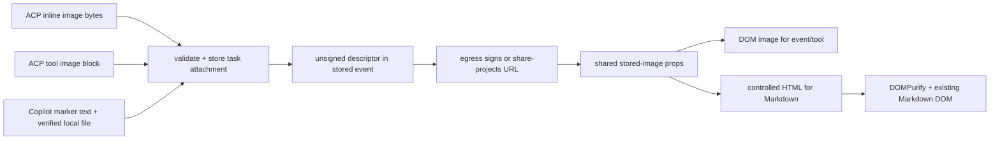

# Agent Image Rendering

WebAgent renders agent-returned images from stored task attachments, never
directly from base64 or arbitrary local paths. This is the primary architecture
reference for image ingestion, placement, replay, and frontend rendering.

## Three sources, three positions

| Source | Stored event shape | Render position |
| --- | --- | --- |
| ACP `agent_message_chunk` image | `agent_image` with an `AgentImageAttachment` | Standalone assistant bubble, `img.agent-image` |
| ACP `tool_call_update.content` image block | Stored attachment descriptor inside tool content | Tool-card thumbnail, `img.tc-image` |
| Copilot `image_generation` path text | Hidden `recoveredCopilotImage` on the tool update | Exact assistant Markdown image position, `img.agent-image` |

Standalone ACP images keep event ordering: pending assistant text is flushed,
the `agent_image` event is stored, and later text starts a later bubble. Tool
images remain thumbnails inside their tool card. The Copilot workaround stores
no visible image content on its tool update; verified Markdown decides whether,
where, and with what alt text the picture appears.

## Storage and egress

All three paths use the same task-local attachment layout:
`<data_dir>/tasks/<taskId>/attachments/<uuid>.<ext>`. Ingest sniffs real bytes,
accepts only renderable supported containers, applies `limits.image_upload`,
records dimensions when available, and stores an unsigned attachment path. A
stored descriptor contains no image payload.

Owner SSE and history egress sign attachment paths. Signatures are never part of
database association identity. Public shares independently map verified facts
to token-scoped `/s/<token>/attachments/...` routes at the snapshot cutoff;
they expose neither owner signed URLs nor original local paths. Owner and share
reference indexes are task- and snapshot-local respectively.

## Shared frontend model

`public/js/stored-image.ts` is the common view-model boundary. It produces:

- validated natural `width`/`height` attributes when both dimensions are
  positive finite numbers;
- `src` from the stored path after the consumer's egress/share rewrite;
- lazy loading;
- the requested `agent-image` or `tc-image` class;
- an alt from the attachment display name for standalone/tool images, or the
  Markdown token alt for registered Markdown images.

Event and tool renderers apply that model directly to DOM `HTMLImageElement`s.
The Markdown renderer serializes the same props into controlled image HTML
before the existing DOMPurify pass. This keeps one prop policy without forcing
inline Markdown through a second DOM construction pipeline.

## Live, replay, and late association

Owner history responses include the task's reference projection independently
of the currently loaded 200-row page. Live SSE registers a new association
before tool/orphan update handling. Repeated updates are idempotent.

A reference is keyed by canonical local file URI. Its attachment identity is
stable; later egress may refresh only the signed query for the same attachment.
A different attachment or base path cannot replace the first binding.

The Markdown stream renderer recognizes only a complete image token. Partial
tokens, unmatched file URIs, code fences, and ordinary links do not request a
file. A late registration invalidates every affected Markdown host and preserves
the host's raw text; block and list/table subcaches retain image dependencies
so cached paragraphs and reused table headers are included in that repaint.

## Security boundaries

- A Copilot reference is a **verified and registered renderable attachment**,
  not authority to read arbitrary local paths.
- Only the Copilot recovery call reads and verifies the named file during live
  `image_generation` handling. Markdown never opens disk paths and does not
  receive local-file capability.
- Unregistered `file:` images have no `src`. CSP and DOMPurify remain strict.
- Raw assistant Markdown is neither rewritten nor reauthored on ingest or flush.
- Share projection starts from verified events at or before `snapshot_seq`.
  Adjacent assistant fragments are projected across the same merge boundary as
  the public viewer, without changing event identity, sequence, or cutoff.
- There is no legacy-row inference. Old tool updates are not promoted from
  `saved_to` text or appended descriptors.

## Copilot shim retirement

Retire the shim when Copilot emits a real ACP image content block from
`image_generation`. Then remove:

1. `src/agent-compatibility/copilot-image-path.ts` and its call/import from
   `src/event-handler.ts`;
2. hidden-reference projection/identity code used only by that workaround;
3. Copilot-specific frontend reference registration and its focused tests and
   documentation.

ACP `agent_image` and ordinary tool-result image behavior remain generic ACP
paths and are not retired with the shim.
