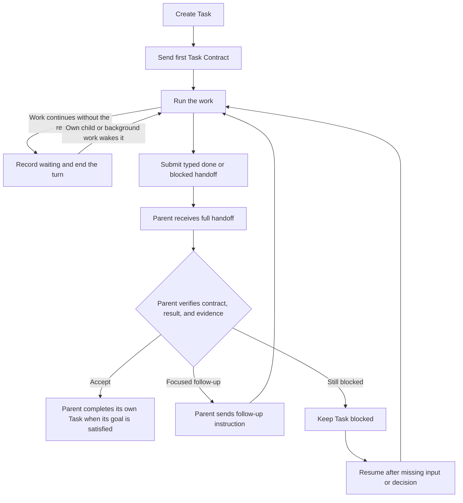

# Task Manual

This is a field guide to using Tasks well: the policy and mental model, not
the mechanism. What each tool does is in its description
([`src/mcp/tools.ts`](../src/mcp/tools.ts)), the accounting rules are in
[Task Obligations](task-obligations.md), and the reference contract is in
[Task MCP Control Plane](task-mcp.md). See [Task Examples](task-examples.md)
for short usage patterns.

## Who decides

WebAgent supervises work and keeps the books, but it does not decide what your
work means. It tells you what it observed — a dispatch was handed over, a turn
ended, a notice went unresolved — and what you can do next. It never decides
that work is complete, failed, or abandoned, and it never starts, continues, or
stops work for you. That decision belongs to the parent Task that dispatched
the work, or to you for a Task you own. Mechanical and safety rules
(authentication, protocol correctness, host protection, and limits you set in
advance) are not task decisions and always apply.

## What a Task is

A Task is a bounded unit of work with its own context, lifecycle, working
location, and place in a Task tree. A Task may be handled by one Agent or by a
workflow that involves several Agents. Task and multi-agent are not synonyms.

Use a Task to give a piece of work a meaningful boundary. Do not create child
Tasks merely because the mechanism exists.

## Start with one Task

The default shape is:

```text
one problem → one Task → one clear completion condition
```

Keep work in one Task when it is sequential, shares context, or is small enough
for one Agent to handle directly. A clear Task should state its goal, scope,
non-goals, and what counts as complete.

## Delegate only when there is a reason

Create child Tasks when the work benefits from one or more of these properties:

- independent investigation;
- context isolation;
- parallel progress;
- a separate responsibility or owner;
- a different execution policy.

Give each child one bounded responsibility. The parent should retain the
problem boundary and the completion condition; the child should own its local
work.

A child creation normally has two conceptual steps: create the Task, then give
it its first instruction. The instruction should provide enough context for the
child to work without repeatedly asking what it is supposed to do.

### Choose where it runs

A Task's agent is an execution choice, not a container: name another
configured agent in `task_create` only when the work benefits from it. Do not
guess what an agent supports; ask for a value you know, or let the target's
default stand. Crossing agents changes nothing about coordination.

### Dispatched work is unattended

A turn opened by an agent message or a runtime reminder answers its own
tool-permission requests on the host side; no person is there to click (see
[Task semantic authority](implementation-invariants.md#task-semantic-authority)).

Two consequences worth internalizing:

- **Tool permission is not a decision point for you to escalate.** If you need
  a *choice* — which behavior, which tradeoff, whether to continue — report
  `blocked` (or send the parent a message). Asking again through a permission
  prompt is not a path, and no one is there to answer it.
- **A person's own turn still prompts.** When a human types in a Task, that
  turn keeps the permission prompt and the Task's `mode`. Do not design a
  workflow that depends on a human answering in a Task's page.

To stop a child's current execution, use `task_cancel`; a later `task_send`
can hand it new work.

## The Task lifecycle

A Task has two related lifecycles: execution and acceptance. The Agent owns
execution; the parent or user decides whether the submitted result is accepted.
The normal delegated shape is:



`task_update(done, ...)` submits a result; it does not mean a parent accepted
it. The handoff should include the conclusion, satisfied criteria, evidence,
limitations, and a next step when useful. `task_update(blocked, ...)` should name the missing input or
decision and explain how the Task can resume. `task_update(waiting, ...)` records
that the work continues without the requester — a Task this one dispatched, or
its own background work, will wake it. It is not delivered, wakes no one, and
does not settle anything: the Task still owes a later `done` or `blocked`.

`task_send` is for ordinary coordination, questions, progress, and follow-up;
it is not a terminal lifecycle handoff. A Task may send useful information and
still need to continue or later submit `done` or `blocked`.

A delegated child owes its requester a typed `done` or `blocked`; `waiting`
does not discharge that debt. The runtime reminds a child that ends a turn
without any update and then tells the requester when it still does not report (see
[Task Obligations](task-obligations.md)). A user-created interactive Task owes
nothing after each turn. After a parent accepts a result, the Task remains
available for history and follow-up.

## Communicate through messages

Use messages as the normal coordination path. A Task should send useful
progress, questions, findings, and decisions to the relevant Task as they arise.
Use `task_update` when the current assignment becomes materially blocked or
complete, or to record `waiting` before ending a turn while your own dispatched
or background work continues; its status is a typed fact, not Task deletion. A final result
should include the conclusion and the evidence needed by the recipient to act
on it. The recipient receives the full handoff body, including important
findings; it should summarize rather than blindly forward a child's raw report.

Task coordination is event-driven:

```text
send or complete a handoff
        ↓
recipient receives a delivery
        ↓
recipient continues or makes a decision
```

A parent should not repeatedly inspect a child while waiting for its result.
Once work has been dispatched, end the current turn and let the completion or
blocking message bring the next decision back to the coordinator. If a
collaboration delivery contains a child result, the parent handles that result
locally; WebAgent does not automatically broadcast the raw handoff to every
ancestor. A parent sends its own summary upward only when its own Task is ready
to report.

## Use lifecycle states deliberately

Use the typed statuses to say whose move it is, not to report ordinary
progress; send progress, findings, and decisions with `task_send`. None of them
deletes or closes the Task.

- Report `done` when the assignment is complete, never for an intermediate
  update.
- Report `blocked` when the next move belongs to the requester or a person:
  say what you need and what happens once you have it. The requester resumes
  you with a message; a blocked state is not a reason to poll.
- Report `waiting` when work continues without the requester — a child you
  dispatched, or your own background command — and you will resume when it
  finishes. Then end the turn, and finish later with `done` or `blocked`. If
  the requester asks while you wait, answer with `task_send`: `waiting` is not
  delivered.

Create a new Task for follow-up work only when it needs a separate boundary,
context, owner, or execution policy.

## Let Tasks contribute at the right level

The parent provides direction and resolves questions that cross boundaries.
Children provide focused work and evidence. Siblings cannot reach each other
directly; when their findings should meet, the parent relays them.

Keep independent analyses independent when diversity of thought matters. Share
findings when another Task can use them to test an assumption, find a counter-
example, or develop a better solution. Coordination should improve the work,
not turn every Task into a shared stream of unrelated conversation.

## Put evidence at the boundary

A handoff is most useful when it carries a compact, verifiable result:

```text
conclusion
→ evidence
→ limitations
→ suggested next step
```

For code, identify the relevant file, symbol or line range, observed behavior,
and causal mechanism. Prefer references and concise explanations over copying
large files or entire transcripts.

History inspection is an exception path. Task history survives `/compact`
and `/clear`, so after either one `task_query` and `task_read` on the current
Task recover what the model context lost; they return stored events, not hidden
reasoning. Do not make history queries the normal way of passing results
between Tasks.

## Keep the workflow proportional

More Tasks and more turns do not automatically produce better work. Before
splitting, ask whether the expected gain from another context or perspective
outweighs its coordination cost.

Stop when the completion condition is met. If work is not converging, make the
uncertainty explicit, narrow the next question, or ask for a stronger decision
rather than adding open-ended iterations.

## A compact mental model

```text
Task boundary
  → clear responsibility
  → message-based coordination
  → explicit handoff
  → evidence-backed decision
```

The Task tree is a structure for boundaries and delivery. It is not a reason to
centralize every thought in the parent, and it is not a global message bus.

## Quick checklist

Before starting:

- What single problem does this Task own?
- What is the completion condition?
- Can one Agent finish it directly?
- If delegation helps, what independent responsibility belongs in each child?

During work:

- Are messages going to the Task that can act on them?
- Is the parent allowing children to work independently where appropriate?
- Is a blocked state asking for an actionable decision?
- Is anyone polling instead of waiting for delivery?
- Before ending a turn while dispatched or background work continues, did the
  Task record `waiting`?

Before finishing:

- Is the result explicitly marked done?
- Does the handoff contain the conclusion and its evidence?
- Are limitations and unresolved questions visible?
- Has the workflow stopped because the goal is complete, rather than because it
  ran out of turns?
